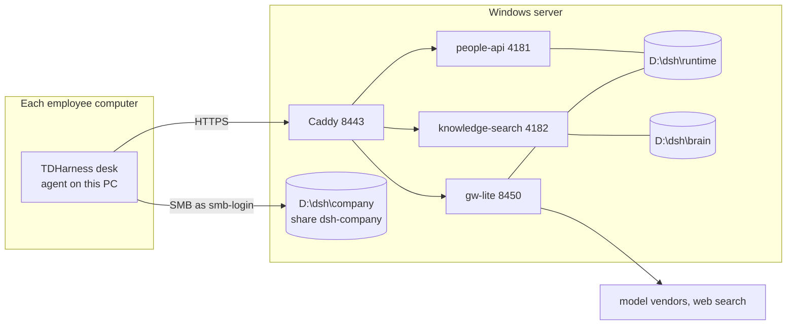

# Architecture

What runs where, who may touch what, and which file does it. For a person taking over a site or this repository. Install and day-to-day running: [docs/SERVER.md](docs/SERVER.md). What is protected: [SECURITY.md](SECURITY.md).

## One server, many desks

## Ports and services

All are scheduled tasks that start at boot and run as SYSTEM; only Caddy listens on the LAN.

| Port | Service (task) | Code | Listens | Reached as |
| --- | --- | --- | --- | --- |
| 8443 | Caddy (`Autostart-Caddy-8443`) | `server/caddy.exe`, Caddyfile from `server/site-cs.py` | LAN, TLS from its own root (`tls internal`) | `/client/*` download page and packages; `/company/login`, `/company/people`, `/company/sessions`, `/company/desk-lease`, `/company/mailbox`, `/company/ops` → 4181; `/company/knowledge` → 4182; `/gw/*` → 8450 |
| 4181 | people API (`Autostart-PeopleApi`) | `server/people-api.py`, `server/tickets.py`, `server/desk_lease.py` | 127.0.0.1 | sign-in, roster, tasks, desk lease, per-person share accounts |
| 4182 | knowledge search (`Autostart-KnowledgeSearch`) | `server/knowledge-search.js`, `server/kb-index.js`, `server/pdf-text.mjs` (+ `vendor/pdfjs`), `server/ocr.py`, `server/legacy-office.py` | 127.0.0.1 | `/company/knowledge` with a login token |
| 8450 | model gateway (`Autostart-Gateway`) | `server/gw-lite.js`, `server/gw-search.js`, `server/web-search.js`, `server/gw-media.js` | dual-stack during the TLS switch, then 127.0.0.1 (`GW_LISTEN=local`) | `/gw/*` with a login token; local jobs with the service token |
| 445 | Windows file sharing | share `dsh-company` → `D:\dsh\company` | LAN | each person's own account `smb-<login>` (`dshshare` only until they have one) |

Nightly tasks (SYSTEM): `TDH-Secure-Folders` 00:05 (`server/secure-folders.ps1 -Apply`), `TDH-Brain-Daily` 00:15 (`server/brain/run-daily.ps1`).

## Files on the server

| Path | Holds | Who can open it | Written by |
| --- | --- | --- | --- |
| `D:\dsh\runtime\gateway.env` | model keys, gateway switches (`DEFAULT_MODEL`, `GW_LISTEN`, transition bridges) | SYSTEM, administrators | Settings → 模型 (admin token), hand edits |
| `D:\dsh\runtime\roster.json` | people, roles, departments, personal folders | same | people API |
| `D:\dsh\runtime\caddy\PASSWORDS.txt` | PBKDF2 password hashes | same | people API |
| `D:\dsh\runtime\gw-tokens.json`, `gw-service.token` | per-person login tokens, the local service token | same | people API, setup |
| `D:\dsh\runtime\smb-users\<login>.pass`, `dshshare.pass` | share-account passwords | same | people API, setup |
| `D:\dsh\runtime\pack-sign\` | Ed25519 update-signing key | same | setup (once) |
| `D:\dsh\runtime\company-ca.crt` | copy of Caddy's TLS root (the root and its key live in SYSTEM's `AppData\Roaming\Caddy`) | same | `server/export-ca.ps1` |
| `D:\dsh\runtime\ocr.json`, `D:\dsh\ocr-venv\` | the Python side of the knowledge search (OCR, old Office files) | same | `server/install-ocr.ps1` |
| `D:\dsh\runtime\kb-cache\` | text pulled out of PDFs, OCR and old Office files | same | knowledge search |
| `D:\dsh\runtime\gw-legacy.json`, `dshshare-seen.json`, `login-known.json` | who still uses a transition bridge or `dshshare`; addresses each login signed in from | same | gateway, secure-folders, people API |
| `D:\dsh\brain\` | knowledge base: raw conversations (`10-l0`), daily pages (`11-l1`, `10-logs`), lessons (`20-l2`, `30-lessons`), inboxes | SYSTEM, administrators | `TDH-Brain-Daily` |
| `D:\dsh\company\` | the company share | per folder, below | desks over SMB, people API |
| `D:\dsh\client-dist\`, `client-history\` | the site's signed desk packages and delta packs | served by Caddy | setup, `server/publish-site-update.ps1` |

## Rights on the company share

Set by `server/secure-folders.ps1` from the roster and each person's account; checked account by account by `server/prove-secure-folders.ps1` (CI runs both on throwaway accounts).

| Folder | Read | Change |
| --- | --- | --- |
| root, `_skills`, `_control`, `content`, `_handbook`, `_handbook\_company` | everyone | admins |
| `_handbook\<dept>` | that department | its director, admins |
| `_shared` (company memory) | everyone | admins, directors |
| `_office` | admins | admins |
| a person's folder (`.dsh-desk` raw conversations, `tasks\` deliverables) and `content\emp-<login>` (`_memory`) | the person, their department's director, admins | the person, admins |

## Who may do what (application level)

| Action | Who | Enforced in |
| --- | --- | --- |
| Use models, web search, image / video | anyone with a live token of an active person | `gw-lite.js` `gate()` |
| Change keys and channels | admins | `gw-lite.js` (POST `/channels`) |
| Add, change, deactivate, remove people | admins | `people-api.py` |
| Issue a task | admins; a director within their department; anyone to themselves | `tickets.py` `may_issue` |
| Review a task | admins; the department's director (not their own card); the issuer | `tickets.py` `can_review` |
| Search the knowledge base | scoped by role and department; raw conversations by path only | `knowledge-search.js` `roots()`, `evidenceAllows()` |

## The desk

`client/CompanyDesk-{win,mac}.zip` are templates: the pinned kernel `@deepseek-ai/dsh` (see `kernel.yml`), Node, the desk plugins (`plugins/company-*`), OpenCLI, Windows-MCP or Peekaboo. Setup and `publish-site-update.ps1` turn them into this site's packages: `server/site-patches/*.py` patch them (each patch carries an `@@mark` and is a no-op the second time), `site-cs.py` writes the site's address and seals `BUILD.json`, `pack-sign.js` signs `version.json`, `pack-delta.py` builds delta packs. The desk checks the signature before an update and its own files on every launch.

The kernel itself is patched by `patches/apply-kernel-patches.js` (anchors that must match exactly once; a missing anchor fails; a patch whose anchors are all gone in a newer kernel is reported as moved). The full set is what the desk packages run; `--only` picks the subset the kernel-only CLI uses. CI applies the full set to the pinned version on every change; `upstream-canary` applies it to the newest published version every night.

**Changing the kernel from the desk** (the version page on the server's own desk, admins only): setup puts `ps-runner.mjs`, `win-kernel-plug-lan.ps1`, `win-kernel-cutover-lan.ps1`, `kernel-selftest.mjs` and the patcher (`runtime\kernel-patch\`, with `strip-creative-preset.ps1`) into `D:\dsh\runtime`, and writes `runtime\dsh-kernel.yml` (the kernel this site runs, and the one to roll back to) once. Download installs a version into `runtime\dsh-<version>`, patches it and boots it against a copy of the desk's home (page, every plugin); switching copies it into the desk and boots it again, and puts the previous kernel back if that fails.

## Proofs

| Script | Proves | Where |
| --- | --- | --- |
| `scripts/prove-gw-auth.js` | gateway answers only live tokens; admin-only key changes; transition bridges recorded; local-only listening | CI (Windows, Linux) |
| `scripts/prove-gw-tls.js` | TLS switch, `/fetch` refuses internal addresses | CI |
| `scripts/prove-people.py` | sign-in, hashes, throttling (incl. known addresses), people management, share accounts, folder rights refreshed | CI (Linux) |
| `scripts/prove-knowledge.js` | who finds what, ranking, PDF / OCR / old Office files, the background queue | CI |
| `scripts/prove-kb-recall.js` | right page first, off-topic refused, synonyms | CI |
| `scripts/prove-secure-folders-ci.ps1` | share rights on throwaway accounts; fails if the share opens again | CI (Windows) |
| `scripts/prove-patches.js` | kernel patches apply to the pinned kernel | CI; nightly on the newest kernel |
| `server/prove-secure-folders.ps1` | share rights on the real server, account by account | on the server |

One-off scripts from past site migrations are in `server/legacy/`; a new install never runs them.
