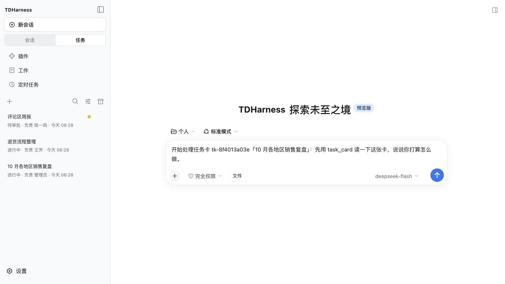
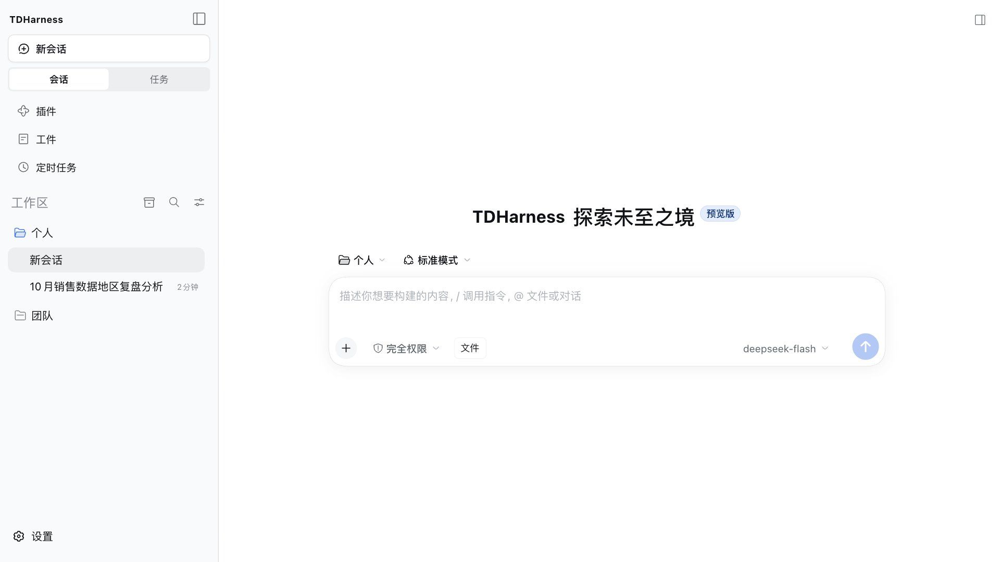
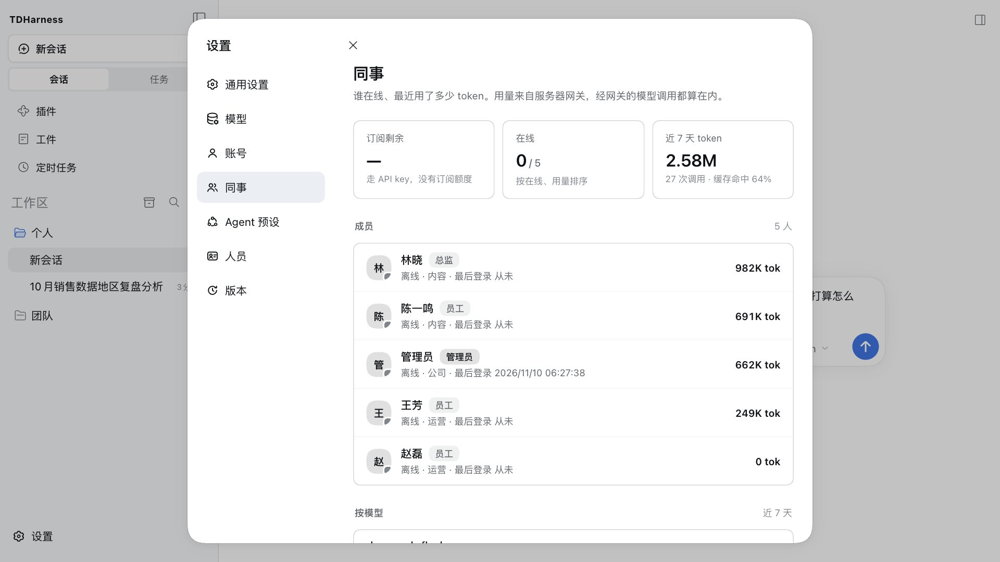
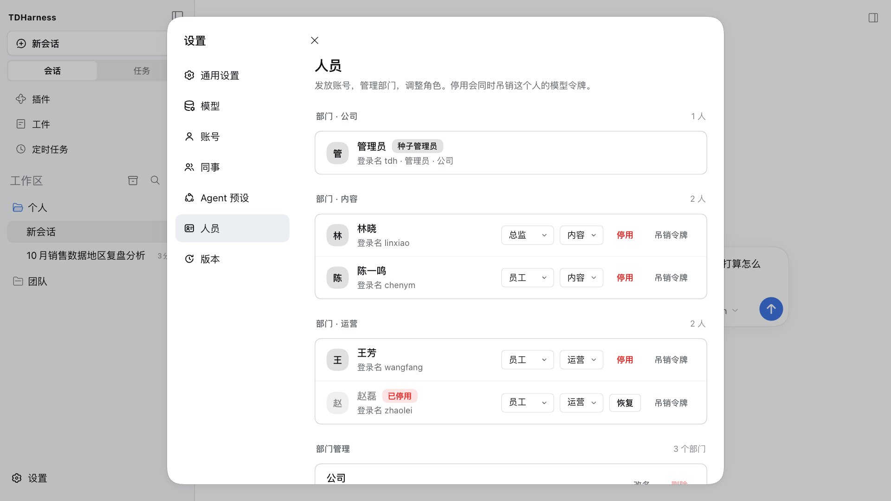
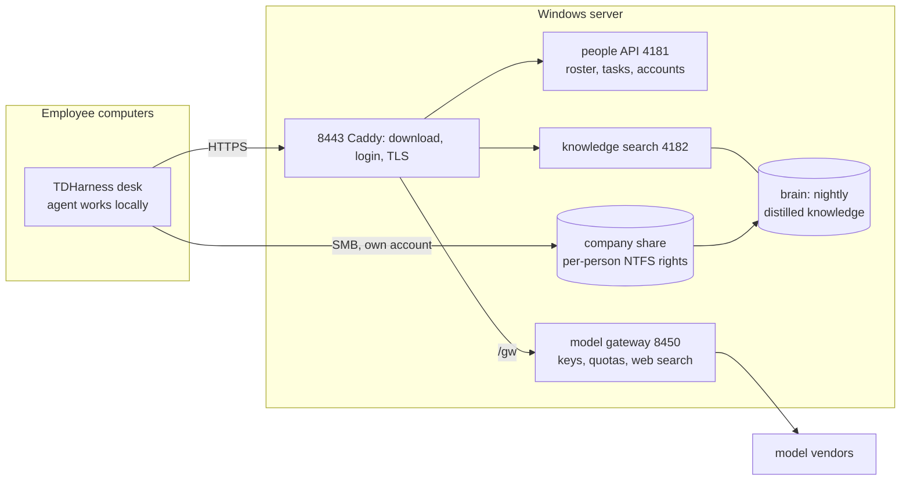

# TDHarness

**A self-hosted AI workbench for a company LAN, installed in one command. Model keys stay on the company server; the agent works on each employee's own computer.**

[中文](README.md) · [Changelog](CHANGELOG.md) · [Security](SECURITY.md) · [Architecture](ARCHITECTURE.md) · [Product write-up](docs/PRODUCT.md)

[](https://github.com/398894496-arch/TDHarness/actions/workflows/prove.yml)
[](https://github.com/398894496-arch/TDHarness/releases)
[](LICENSE)

**Version: 2026.11.10**



TDHarness (TDH) lets a company run AI agents inside its own office network:

- **One Windows PC is the server.** It holds the model keys and subscriptions, the company share, the roster and the knowledge base. One command installs everything; no Docker, no cloud account.
- **Employees install a desktop client on their own Windows PC or Mac** and sign in with a company account. The agent works on that computer: files, commands, the browser, desktop apps.
- **Model calls and web search go only through that server.** Keys never reach the desks. Deactivating one person cuts off their sign-in, models, knowledge base and company share on the next request, and nobody else is affected.
- **What people learn stays in the company.** Every night the server distils everyone's AI work and the company's documents into a knowledge base; who can find what is scoped by person and department.

Built on [DeepSeek Harness](https://github.com/deepseek-ai/deepseek-harness) (`dsh`), patched for a company setting. MIT; third-party parts in [NOTICE.md](NOTICE.md). The interface is in Chinese.

## What it looks like

| Session | Colleagues | Personnel |
| --- | --- | --- |
|  |  |  |
| Personal and team workspaces, model picker, access level | Who is online, role, last login, 7-day local cost estimate | Roster by department; deactivate, remove, force a fresh sign-in |

The screenshots use made-up people and tasks. Each screen is described in [docs/PRODUCT.md](docs/PRODUCT.md#what-the-running-desk-does).

## Is it for you?

| Good fit | Not a fit |
| --- | --- |
| 10–50 people on one office LAN, one Windows PC that can stay on as the server | Hosted SaaS, or a server on Linux / in Docker (the server is Windows-only today) |
| You want everyone's AI to *do* the work on their own machine, with keys, quotas and the company disk controlled centrally | A chat UI only, or a document Q&A portal over thousands of files (see the comparison below) |
| Chinese office documents: Word / Excel / PowerPoint, WPS, PDF, scanned paper | Semantic search across wording: search is keyword-based (BM25), no vector store yet |
| Someone on site who can read PowerShell and Node when something breaks | Sign-in through AD / LDAP / SSO (accounts are TDH's own roster today) |

## Install

### Step 1: the server (one Windows PC, once)

Needs Windows 10/11 or Windows Server, Administrator, and Git with Git LFS, Node 22+ and Python 3 already installed. The built-in Windows PowerShell is enough (PowerShell 7 `pwsh` also works).

```powershell
git clone https://github.com/398894496-arch/TDHarness.git
cd TDHarness
git lfs pull
powershell -ExecutionPolicy Bypass -File scripts\setup-all.ps1
```

Green: `SITE_INSTALL_OK=1`, `LOGIN_PROVE_OK=1`, `GUI_PROVE_OK=1`, `PLANT_CLIENT_OK=1`. That one command sets up login, the seed admin, the roster, the model gateway, the knowledge base and its nightly job, the download page, and both desktop clients compiled for this LAN.

**The default admin is `tdh`, with a random initial password for every install.** Setup prints it on the `DEFAULT_PASSWORD=` line and keeps it in `D:\dsh\runtime\caddy\seed-admin.txt` on the server (administrators only). Sign in from the desktop shortcut and **change it straight away in Settings → 账号 → 修改密码**; the file is deleted when you do. Re-running setup never overwrites existing accounts or passwords.

Then add a model: Settings → 模型 as the admin, or edit `D:\dsh\runtime\gateway.env` ([server/gateway.env.example](server/gateway.env.example)). OpenAI, Anthropic, DeepSeek, xAI / a Grok subscription, Kimi, Zhipu GLM and any OpenAI-compatible endpoint are supported. The gateway reads the file on every request, no restart. ChatGPT and Claude consumer subscriptions are personal plans and are not relayed to a team; use their API keys. Details: [docs/SERVER.md](docs/SERVER.md#models-keys-stay-on-this-machine).

The site address defaults to this PC's `<computername>.local`; add `-HostName <ip>` only for clients on another subnet. Client updates are signed with a key setup creates on this PC: back it up ([docs/SERVER.md](docs/SERVER.md#client-updates-are-signed)). Upgrade, back up, uninstall: [docs/SERVER.md](docs/SERVER.md#upgrade-back-up-uninstall).

### Step 2: employees

| System | How |
| --- | --- |
| Windows | Open `https://<computername>.local:8443/`, click 下载 Windows 版, run `TDHarness-Setup.exe` |
| Mac (Apple silicon and Intel) | Same page, 下载 macOS 版, unzip, drag TDHarness to Applications |

The browser warns about the self-signed certificate once. Sign in with the account an admin created in Settings → 人员. Employees never touch patches, Node or a command line.

### Updates

An admin runs `server\publish-site-update.ps1`; desks offer the update on their next launch. Updates are signed, delta when possible, and resumable.

### Questions people ask

**No login or team features after installing?** You most likely ran `scripts/setup.sh` or `scripts\setup.ps1`. Those install only the single-machine CLI kernel: no login, no team, no company disk, no knowledge base. The team desk is Step 1 above, `scripts\setup-all.ps1` on a Windows server.

**Why is there no Setup.exe on the Releases page?** Each site's client installer carries that server's address and that server's own update-signing key, so setup compiles it on the server. A generic download would not know where to sign in or whose updates to trust.

**What does "patch tree" mean here?** It describes the source, not the delivery: the upstream kernel `@deepseek-ai/dsh` is pinned in [kernel.yml](kernel.yml) and installed from npm, and this repo's patches are applied on top during setup, instead of keeping a vendored fork of upstream.

**What is not in this repo?** Company documents, knowledge-base text, subscription keys, Tailscale auth or an office roster. Those are local to whoever runs setup.

## What it does

- **Task cards with hand-in and review.** Each card has a state and an owner; opening one starts a conversation pinned to it. Deliverables go on the company disk, and only 提交验收 counts as done, not saying so in chat.
- **A knowledge base filled every night.** Task `TDH-Brain-Daily` (00:15) distils each person's conversations of the day. Company documents go in the handbook folders on the company share: Word, Excel, PowerPoint (new and old formats), WPS, PDF, and scans or photos through OCR in the background. Search is ranked (BM25, Chinese by two-character terms), answers only a live login token, and is scoped by person and department. Details: [docs/KNOWLEDGE.md](docs/KNOWLEDGE.md).
- **Web search through the gateway.** Chinese queries go to domestic engines first with Exa alongside; GitHub, Bilibili and YouTube have their own channels. A query starting with `深搜 ` is answered by Grok's own web search with sources.
- **Browser and desktop apps.** The Windows client ships OpenCLI with its Chrome extension and [Windows-MCP](https://github.com/CursorTouch/Windows-MCP); the Mac client ships [Peekaboo](https://github.com/openclaw/Peekaboo). Exporting, overwriting, deleting or sending waits for the person's yes.
- **Generated images and videos in the conversation**, each with a download button. An image can be marked up on a canvas so only the marked region is changed.
- **Workspaces that follow the person.** Conversations live in the person's own folder on the company share and are there on the next computer they sign in from.
- **Long conversations.** Context is compacted automatically at 80% of the model's window; `/compact` does it by hand.
- **Talking-head editing (optional).** `server\koubo\install.ps1` installs a tool that turns a recording into a Jianying (CapCut China) draft: transcription, cuts, subtitles and layouts.

Full write-up: [docs/PRODUCT.md](docs/PRODUCT.md).

## How it fits together



More in [ARCHITECTURE.md](ARCHITECTURE.md) and [docs/SERVER.md](docs/SERVER.md).

## Compared with

These are good projects; pick by what you need. TDH is the one where the agent works on each employee's own computer while the company keeps the keys, the people and the disk.

| If you mainly want… | Look at |
| --- | --- |
| A self-hosted ChatGPT-style web UI for a team, with document chat | [Open WebUI](https://github.com/open-webui/open-webui), [LibreChat](https://github.com/danny-avila/LibreChat) |
| To build RAG apps and workflows, or Q&A over a large document library with vector search | [Dify](https://github.com/langgenius/dify), [RAGFlow](https://github.com/infiniflow/ragflow), [MaxKB](https://github.com/1Panel-dev/MaxKB) |
| A single-user desktop document assistant | [AnythingLLM](https://github.com/Mintplex-Labs/anything-llm) |
| Agents that edit files, run commands and drive the browser and desktop apps on each employee's PC, under company accounts, keys and a shared company disk, installed on a LAN in one command | **TDH** |

They combine: a Dify or RAGFlow instance can sit next to TDH for large-scale document Q&A.

## Known limits

- The server is Windows only; the knowledge search is keyword-based (no embeddings); no AD / LDAP / SSO; no handwriting OCR, and scanned tables lose their grid.
- The agent has the employee's own rights on their computer. TDH does not pretend to stop the employee; it controls keys, quotas, the company disk and who sees what ([SECURITY.md](SECURITY.md)).
- The server's own administrators can open everything on the server.
- The kernel is an alpha upstream; this repo pins it, patches it and fails hard when a patch no longer applies.
- The two desk templates (`client/*.zip`: kernel, Node and the bundled tools) are built by the maintainer and CI does not rebuild them ([NOTICE.md](NOTICE.md#what-ships-as-binaries-and-where-it-comes-from)). The desk's own parts (plugins, start and update scripts, skills, profile) are source in [desk/](desk/README.md) and replace the templates' copy at every install and publish; the Mac launcher binary is the one part of ours whose source is not here yet.

## Status

Young and moving fast, run in production. Started September 2026; in daily use at two small companies (about 5 and 22 accounts). Every merge to `main` cuts [a dated release](https://github.com/398894496-arch/TDHarness/releases) with notes, automatically. Two contributors besides the maintainer have code merged.

Every merge runs 24 proof scripts on Windows and Linux in CI: login and gateway authorisation, the TLS switch, knowledge-search permissions and ranking, people management, company-share rights, patches, release notes, secret scan and more. The agent kernel is upstream `@deepseek-ai/dsh` **0.2.1-alpha.1**, pinned in [kernel.yml](kernel.yml) together with the client packages; CI applies every patch to exactly that version and fails if one no longer applies ([docs/UPSTREAM.md](docs/UPSTREAM.md)). Five rounds of third-party review so far; each finding and its fix is in the changelog.

## Kernel-only (optional)

<details>
<summary>Only the patched <code>dsh</code> CLI, no server</summary>

This path does **not** give you the team desk above: no login, no team, no company disk, no knowledge base, no shared model keys.

Needs Node 22+, your own DeepSeek (or OpenAI-compatible) API key, and a **local** folder as the workspace (not UNC / a network drive).

```bash
git clone https://github.com/398894496-arch/TDHarness.git
cd TDHarness
bash scripts/setup.sh
export PATH="$HOME/.tdh-coding-prefix/bin:$PATH"
export DEEPSEEK_API_KEY='your-key'
dsh --patch "$PWD/overlays/solo.yml"
```

Windows kernel: `powershell -ExecutionPolicy Bypass -File scripts\setup.ps1`. This installs `@deepseek-ai/dsh` from `kernel.yml` into `~/.tdh-coding-prefix` and applies the coding patch subset. It does **not** start 8443 / 8450 / knowledge. Do not point it at a live `node_modules`. The company pins stay off unless `TDH_FULL_PATCHES=1`.

Green: `bash scripts/prove-scan.sh` → `SCAN_OK=1`. After setup: `node scripts/prove-patches.js` → `PATCH_PROVE_OK=1`. Local ChatGPT / Grok / Claude login and custom endpoints: [docs/MODELS.md](docs/MODELS.md) (`node scripts/prove-models.js` → `MODELS_PROVE_OK=1`).

</details>

## Contributing

Questions, install feedback and ideas go in [Discussions](https://github.com/398894496-arch/TDHarness/discussions); bugs go in Issues.

Code: fork + PR. Open a **Task** issue first with a proposal and its green line. [CONTRIBUTING.md](CONTRIBUTING.md); every listed item (C1–C9, C2b) is closed in [BUGS.md](BUGS.md). Upstream door (no PRs): [docs/UPSTREAM.md](docs/UPSTREAM.md).
