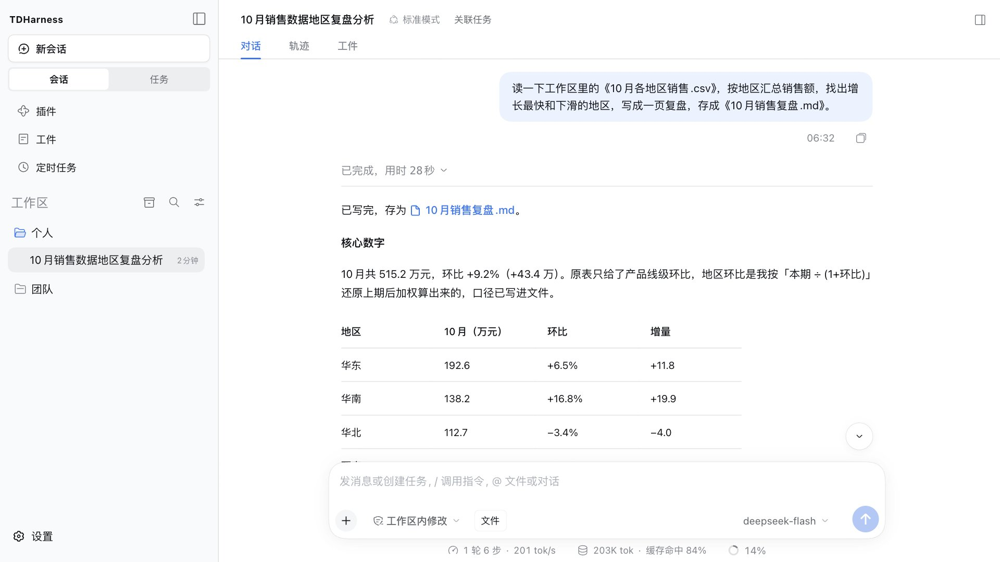
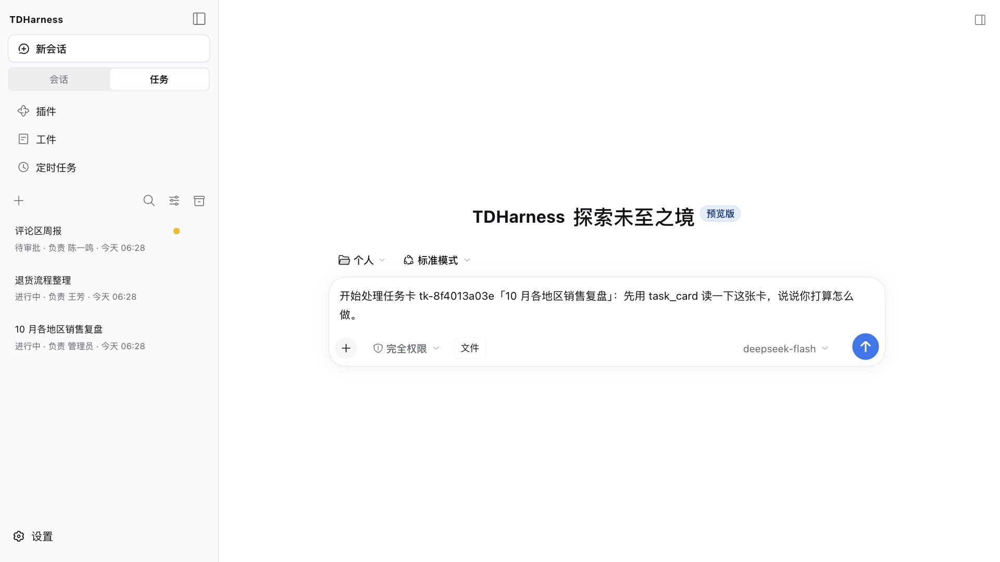
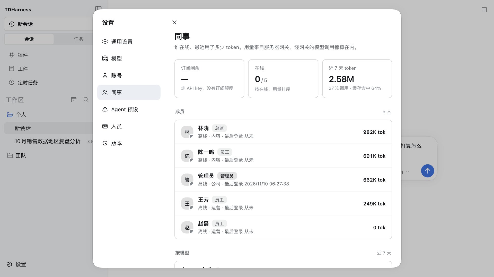
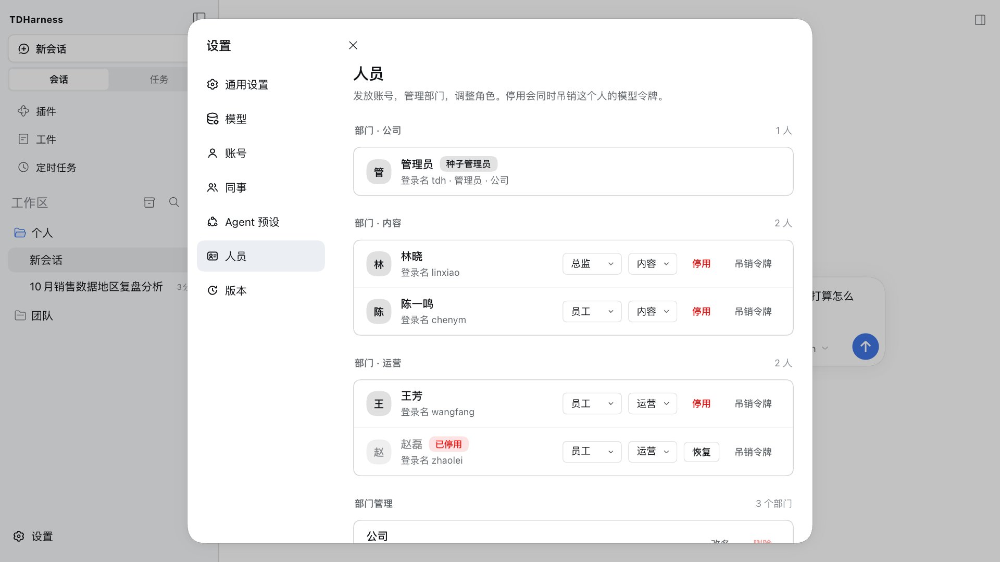
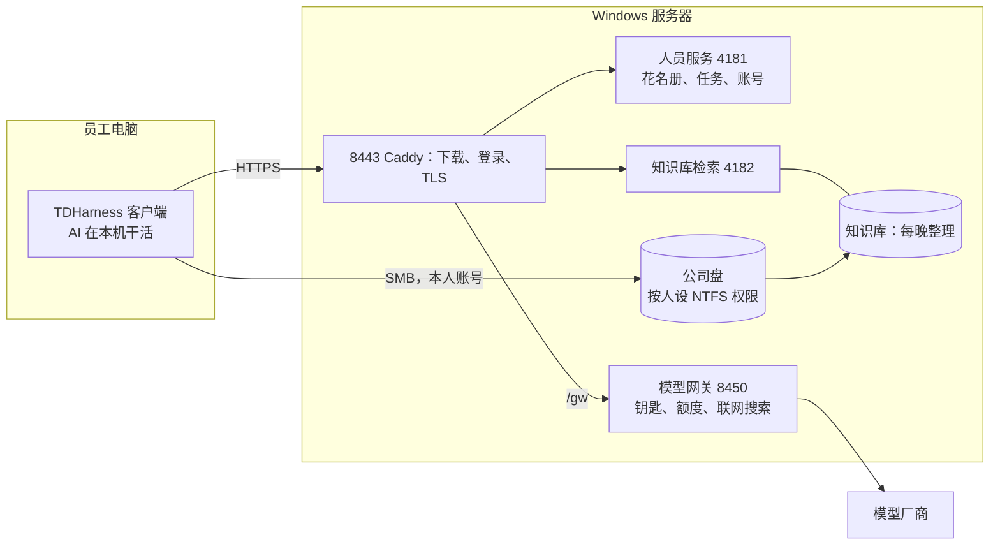

# TDHarness

**一键安装的局域网 AI 工作台。模型钥匙留在公司服务器上，AI 在每个员工自己的电脑上干活。**

[English](README.en.md) · [项目讲解](docs/BRIEF.zh.md) · [更新说明](CHANGELOG.md) · [安全说明](SECURITY.md) · [架构](ARCHITECTURE.md)

[](https://github.com/398894496-arch/TDHarness/actions/workflows/prove.yml)
[](https://github.com/398894496-arch/TDHarness/releases)
[](LICENSE)

**当前版本 / Version: 2026.11.10**



TDHarness（简称 TDH）让一家公司在自己的局域网里用上 AI Agent：

- **一台 Windows 电脑当服务器**，管着模型钥匙和订阅、公司盘、花名册和知识库。一条命令装完，不用 Docker，不用云账号。
- **员工在自己的 Windows 或 Mac 上装客户端**，用公司账号登录。AI 在这台电脑上改文件、跑命令、操作浏览器和桌面软件。
- **模型调用和联网搜索只经过公司那台服务器。** 钥匙不下发到员工电脑；停用一个人，他的登录、模型、知识库和公司盘在下一次请求就全部停掉，不影响别人。
- **经验留在公司。** 服务器每晚把所有人当天的 AI 对话和公司文档整理进知识库，谁能搜到什么按人和部门控制。

基于 [DeepSeek Harness](https://github.com/deepseek-ai/deepseek-harness)（`dsh`），按公司场景打了补丁。MIT 许可，第三方部分见 [NOTICE.md](NOTICE.md)。

## 长什么样

| 任务 | 同事 | 人员 |
| --- | --- | --- |
|  |  |  |
| 任务卡有状态和负责人，点开就带着任务开工 | 谁在线、角色、最后登录、近七日用量 | 按部门管花名册，改角色、停用、吊销令牌 |

最上面那张是一段真实对话：销售表是编的，回答由模型生成。截图里的人名、任务和用量都是演示数据。每个界面的详细说明见 [项目讲解](docs/BRIEF.zh.md#打开之后是什么)。

## 适合谁

| 适合 | 不适合 |
| --- | --- |
| 10–50 人，在同一个办公室局域网，有一台能常开的 Windows 电脑当服务器 | 想要托管 SaaS，或者服务器要跑在 Linux / Docker 上（目前服务器只支持 Windows） |
| 想让每个人的 AI 在自己电脑上真的把活干了，钥匙、额度和公司盘由公司统一管 | 只想要一个聊天界面，或者几千份文档的问答门户（见下面的对比） |
| 中文办公文档：Word / Excel / PowerPoint、WPS、PDF、扫描件 | 需要按意思搜索（搜「费用核销」找到「报销」）：目前是关键词检索（BM25），没有向量库 |
| 现场有人在出问题时能看懂 PowerShell 和 Node | 需要 AD / LDAP / SSO 登录（目前账号是 TDH 自己的花名册） |

## 安装

### 第一步：装服务器（一台 Windows，装一次）

需要 Windows 10/11 或 Windows Server、管理员权限，事先装好 Git（含 Git LFS）、Node 22+、Python 3。系统自带的 Windows PowerShell 就够用。

```powershell
git clone https://github.com/398894496-arch/TDHarness.git
cd TDHarness
git lfs pull
powershell -ExecutionPolicy Bypass -File scripts\setup-all.ps1
```

看到 `SITE_INSTALL_OK=1`、`LOGIN_PROVE_OK=1`、`GUI_PROVE_OK=1`、`PLANT_CLIENT_OK=1` 就是装好了。这一条命令装出：登录、种子管理员、花名册、模型网关、知识库和每晚的整理任务、下载页，以及按这台服务器编译好的 Windows 和 Mac 客户端。

**默认管理员账号是 `tdh`，初始密码每次安装随机生成**：装机结束时显示在 `DEFAULT_PASSWORD=` 这一行，也存在服务器的 `D:\dsh\runtime\caddy\seed-admin.txt`（只有管理员能读）。用桌面快捷方式打开后登录，**马上在 设置 → 账号 → 修改密码 里改掉**，那个文件随之删除。重跑安装不会覆盖已有的账号和密码。

然后填模型：用管理员账号进 设置 → 模型，填 API key 或接订阅。支持 OpenAI、Anthropic、DeepSeek、xAI / Grok 订阅、Kimi、智谱 GLM，以及任何 OpenAI 兼容地址。

服务器地址默认是这台电脑的 `<计算机名>.local`；员工电脑在另一个网段时才需要加 `-HostName <ip>`。客户端更新用装机时在这台电脑上生成的钥匙签名，记得备份（[docs/SERVER.md](docs/SERVER.md#client-updates-are-signed)）。升级、备份、卸载也在 [docs/SERVER.md](docs/SERVER.md#upgrade-back-up-uninstall)。

### 第二步：员工装客户端

| 系统 | 怎么装 |
| --- | --- |
| Windows | 浏览器打开 `https://<服务器计算机名>.local:8443/`，点「下载 Windows 版」，双击 `TDHarness-Setup.exe` |
| Mac（Apple 芯片和 Intel） | 同一页点「下载 macOS 版」，解压后把 TDHarness 拖进「应用程序」 |

浏览器第一次会提示证书是自签名的。装完用管理员在 设置 → 人员 里建的账号登录。员工不碰补丁、Node 或命令行。

### 以后更新

管理员在服务器上运行 `server\publish-site-update.ps1`，员工下次打开客户端时提示更新。更新带签名校验，能增量就增量，支持断点续传。

### 常见疑问

**装完没有登录和团队功能？** 你装的多半是 `scripts/setup.sh` 或 `scripts\setup.ps1`。那两个只装单机命令行内核，没有登录、团队、公司盘和知识库。团队版要按上面第一步在 Windows 服务器上运行 `scripts\setup-all.ps1`。

**为什么 Releases 页没有安装包？** 每家公司的客户端安装包里写着自己服务器的地址和这台服务器自己的更新签名钥匙，所以由装机脚本在服务器上现场编译。通用安装包不知道该去哪登录、该信谁发的更新。

**仓库里有什么不该有的吗？** 没有公司文档、知识库内容、订阅钥匙、Tailscale 授权或任何一家的花名册。这些只存在于运行安装的那台机器上。

## 能做什么

- **任务卡加验收。** 每张卡有状态和负责人，点开就带着任务开工。交付物放公司盘，只有「提交验收」才算做完，聊天里说做完了不算。
- **知识库每晚自己长。** 每天 00:15 整理当天所有人的对话；公司文档放进公司盘的手册目录即可，Word、Excel、PowerPoint（新旧格式）、WPS、PDF 直接读，扫描件和照片在后台 OCR。检索只认登录令牌，按人和部门控制范围。详见 [docs/KNOWLEDGE.md](docs/KNOWLEDGE.md)。
- **联网搜索走公司网关。** 中文问题先走国内搜索引擎，GitHub、B 站、YouTube 有专门通道。
- **操作浏览器和桌面软件。** Windows 客户端自带 OpenCLI 和 [Windows-MCP](https://github.com/CursorTouch/Windows-MCP)，Mac 客户端自带 [Peekaboo](https://github.com/openclaw/Peekaboo)。导出、覆盖、删除、发送之前先问员工。
- **生成的图片和视频在对话里直接看、直接下载。** 图片还能在画布上涂出要改的地方，只改那一块。
- **工位跟着人走。** 对话存在公司盘上自己的工位里，换一台电脑登录还在。
- **长对话自动压缩。** 上下文到模型窗口的 80% 自动压缩，也可以用 `/compact` 手动压。
- **口播剪辑（可选装）。** 把一条录音剪成剪映草稿：转写、剪口误、字幕和版式。

每一项的完整说明：[项目讲解](docs/BRIEF.zh.md)（中文）、[docs/PRODUCT.md](docs/PRODUCT.md)（英文）。

## 它是怎么搭起来的



更多见 [ARCHITECTURE.md](ARCHITECTURE.md) 和 [docs/SERVER.md](docs/SERVER.md)。

## 和别的项目怎么选

这些都是好项目，按需要选。TDH 的位置是：Agent 在每个员工自己的电脑上干活，钥匙、人和公司盘由公司管。

| 如果你主要想要 | 看这些 |
| --- | --- |
| 给团队自建一个 ChatGPT 式的网页界面，带文档对话 | [Open WebUI](https://github.com/open-webui/open-webui)、[LibreChat](https://github.com/danny-avila/LibreChat) |
| 搭 RAG 应用和工作流，或者对大量文档做向量检索问答 | [Dify](https://github.com/langgenius/dify)、[RAGFlow](https://github.com/infiniflow/ragflow)、[MaxKB](https://github.com/1Panel-dev/MaxKB) |
| 单人用的桌面文档助手 | [AnythingLLM](https://github.com/Mintplex-Labs/anything-llm) |
| Agent 在每个员工的电脑上改文件、跑命令、操作浏览器和桌面软件，用公司账号、公司钥匙和公司盘，一条命令装在局域网里 | **TDH** |

可以搭配用：大规模文档问答交给旁边的 Dify 或 RAGFlow。

## 已知限制

- 服务器只支持 Windows；知识库是关键词检索，没有向量；没有 AD / LDAP / SSO；不识别手写，扫描的表格会丢表格线。
- Agent 拥有员工本人在这台电脑上的权限。TDH 不假装能防住员工本人，它管的是钥匙、额度、公司盘和谁能看到什么（[SECURITY.md](SECURITY.md)）。
- 服务器自己的管理员能打开服务器上的一切。
- 内核是上游的 alpha 版。本仓锁定版本、打补丁，补丁打不上时直接失败。
- 两个客户端模板（`client/*.zip`：内核、Node 和自带工具）由维护者构建，CI 不重新构建（[NOTICE.md](NOTICE.md#what-ships-as-binaries-and-where-it-comes-from)）。客户端里属于本项目的部分（插件、启动和更新脚本、技能、配置）源码在 [desk/](desk/README.md)，每次安装和发布时替换模板里的那份；Mac 启动器是唯一还没放出源码的自有部分。

## 项目状态

2026 年 9 月开始，迭代很快，已在生产环境使用：两家小公司每天在用（约 5 个和 22 个账号）。每次合进 `main` 自动发一个带说明的[日期版本](https://github.com/398894496-arch/TDHarness/releases)。维护者之外，已有 2 位贡献者的代码合入。

每次合并在 Windows 和 Linux 上跑 22 项证明脚本：登录和网关鉴权、TLS 切换、知识库权限和排序、人员管理、公司盘权限、补丁、版本说明、密钥扫描等。内核是上游 `@deepseek-ai/dsh` **0.2.1-alpha.1**，和客户端包一起锁在 [kernel.yml](kernel.yml)；CI 把每个补丁打到这个版本上，打不上就失败（[docs/UPSTREAM.md](docs/UPSTREAM.md)）。至今做过五轮第三方审查，每条发现和修复都写在更新说明里。

## 只要命令行内核（可选）

<details>
<summary>只想要打过补丁的 <code>dsh</code> 命令行，不要服务器</summary>

这条路**不会**装出上面的团队工作台：没有登录、团队、公司盘、知识库和共享的模型钥匙。

需要 Node 22+、自己的 DeepSeek（或 OpenAI 兼容）API key，以及一个**本地**文件夹当工作区（不能是 UNC 路径或网络盘）。

```bash
git clone https://github.com/398894496-arch/TDHarness.git
cd TDHarness
bash scripts/setup.sh
export PATH="$HOME/.tdh-coding-prefix/bin:$PATH"
export DEEPSEEK_API_KEY='your-key'
dsh --patch "$PWD/overlays/solo.yml"
```

Windows：`powershell -ExecutionPolicy Bypass -File scripts\setup.ps1`。它按 `kernel.yml` 把 `@deepseek-ai/dsh` 装进 `~/.tdh-coding-prefix`，只打本地工作区那一部分补丁。不要把它指向正在使用的 `node_modules`。

验证：`bash scripts/prove-scan.sh` → `SCAN_OK=1`；装完后 `node scripts/prove-patches.js` → `PATCH_PROVE_OK=1`。本机登录 ChatGPT / Grok / Claude 和自定义端点见 [docs/MODELS.md](docs/MODELS.md)。

</details>

## 参与

使用问题、装机反馈和想法发在 [Discussions](https://github.com/398894496-arch/TDHarness/discussions)，Bug 开 Issue。

改代码：Fork 后提 PR。先开一个 **Task** issue 说明要做什么和验收的那一行输出。细则见 [CONTRIBUTING.md](CONTRIBUTING.md) 和 [寻找共建者](docs/WANTED.zh.md)；已关闭的缺口清单在 [BUGS.md](BUGS.md)。上游不收外部 PR，见 [docs/UPSTREAM.md](docs/UPSTREAM.md)。
