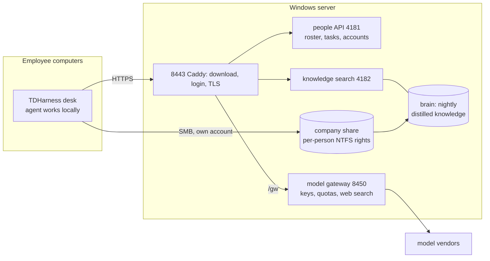
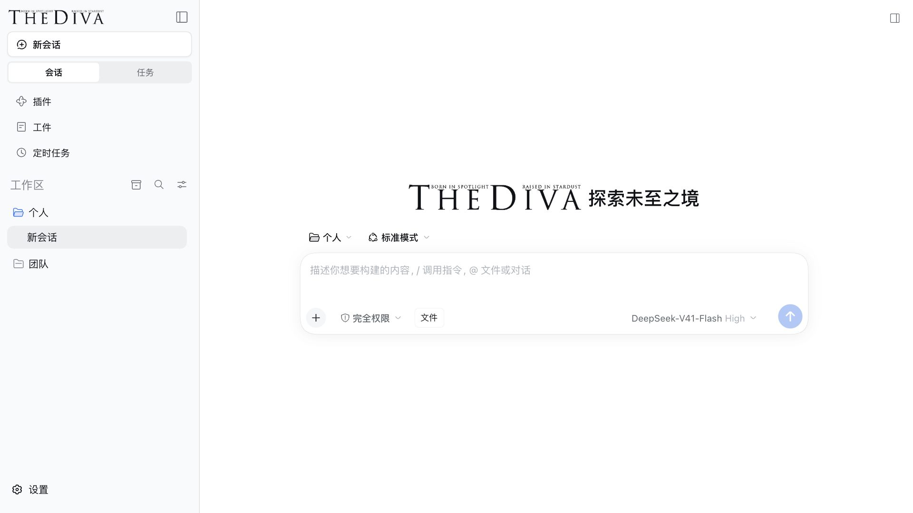
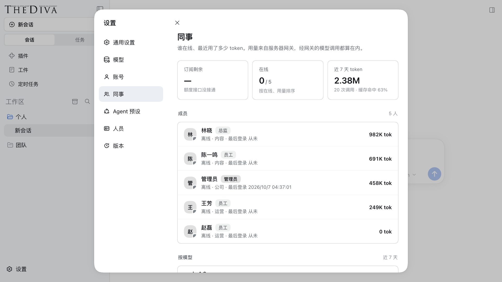
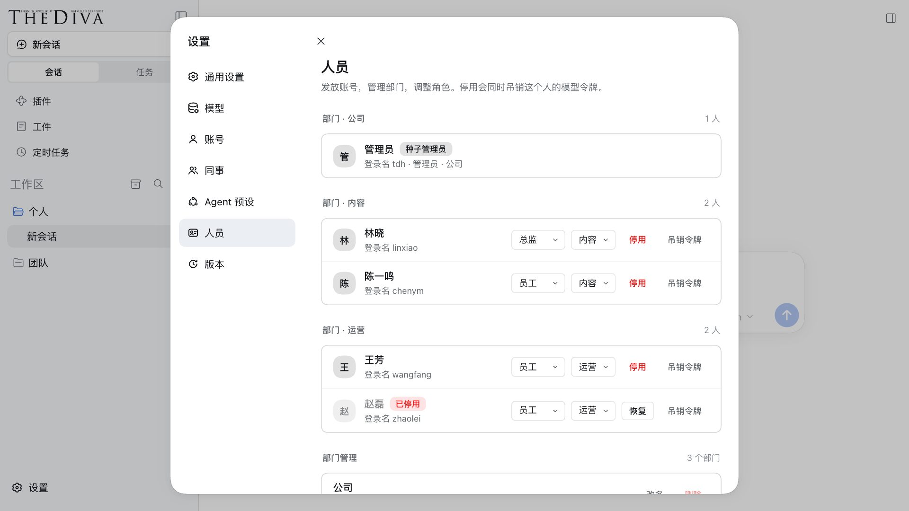
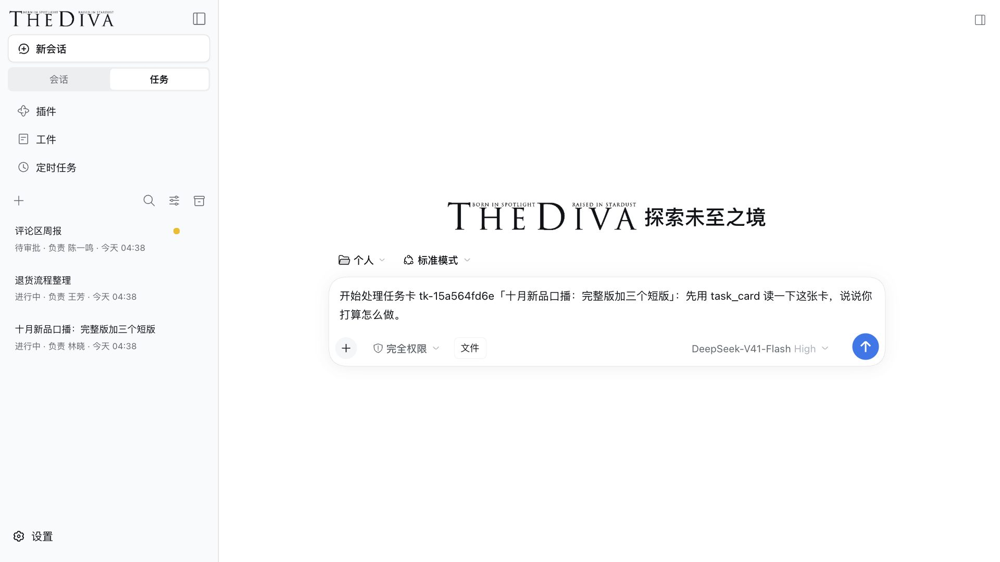

# TDHarness-coding

[](https://github.com/398894496-arch/TDHarness-coding/actions/workflows/prove.yml)
[](https://github.com/398894496-arch/TDHarness-coding/releases)
[](LICENSE)

**当前版本 / Version: 2026.10.11.7** · [更新说明 / Changelog](CHANGELOG.md) · [Security](SECURITY.md) · [Architecture](ARCHITECTURE.md)

**TDH (TDHarness) is a self-hosted AI workbench for a company LAN.** One Windows server holds the model keys and subscriptions, the company share, the roster and the knowledge base; employees run a desktop client (Windows or Mac) whose agent works on their own computer (files, commands, browser, desktop apps); its model calls and web search go only through that server. It is built on [DeepSeek Harness](https://github.com/deepseek-ai/deepseek-harness) (`dsh`), patched for a company setting. 中文：一台 Windows 服务器管模型钥匙、公司盘、花名册和知识库；员工电脑装桌面客户端，AI 在员工自己的电脑上干活，模型调用和联网搜索只经过这台服务器。

| | |
| --- | --- |
| **Server** | One Windows 10/11 or Windows Server PC; one command installs everything; no Docker, no cloud account |
| **Clients** | Windows and macOS (Apple silicon and Intel), installed from the server's download page; signed, delta updates |
| **Models** | OpenAI, Anthropic, DeepSeek, xAI / Grok subscription, Kimi, GLM, any OpenAI-compatible endpoint; keys never leave the server |
| **People** | Roster with departments and roles (employee, director, admin), per-person tokens, deactivate takes everything away on the next request |
| **Work** | Task cards with hand-in and review, a shared company disk, per-person workspaces that follow the person between computers |
| **Knowledge** | Nightly distillation of everyone's AI work plus company documents (Office, WPS, PDF, scans via OCR), ranked search scoped by person and department ([details](docs/KNOWLEDGE.md)) |
| **License** | MIT; third-party parts in [NOTICE.md](NOTICE.md) |

### Is it for you?

| Good fit | Not a fit |
| --- | --- |
| 10–50 people on one office LAN, one Windows PC that can stay on as the server | Hosted SaaS, or a server on Linux / in Docker (the server is Windows-only today) |
| You want everyone's AI to *do* the work on their own machine, with keys, quotas and the company disk controlled centrally | A chat UI only, or a document Q&A portal over thousands of files (see the comparison below) |
| Chinese office documents: Word / Excel / PowerPoint, WPS, PDF, scanned paper | Semantic search across wording ("费用核销" finding "报销"): search is keyword-based (BM25), no vector store yet |
| Someone on site who can read PowerShell and Node when something breaks | Sign-in through AD / LDAP / SSO (accounts are TDH's own roster today) |

### Status

Young and moving fast, run in production. Started September 2026; [a dated release](https://github.com/398894496-arch/TDHarness-coding/releases) with notes for every merge to `main`, cut automatically. In daily use at two small companies (about 5 and 22 accounts). Four contributors so far. Every merge runs 12 proof scripts on Windows and Linux in CI (login and gateway authorisation, TLS switch, knowledge-search permissions and ranking, people management, patches, release notes, secret scan). The agent kernel is upstream `@deepseek-ai/dsh` **0.2.1-alpha.1**, pinned in [kernel.yml](kernel.yml) together with the client packages; CI applies every patch to exactly that version and fails if one no longer applies ([docs/UPSTREAM.md](docs/UPSTREAM.md)). Five rounds of third-party review so far; each finding and its fix is in the changelog.



### Compared with

These are good projects; pick by what you need. TDH is the one where the agent works on each employee's own computer while the company keeps the keys, the people and the disk.

| If you mainly want… | Look at |
| --- | --- |
| A self-hosted ChatGPT-style web UI for a team, with document chat | [Open WebUI](https://github.com/open-webui/open-webui), [LibreChat](https://github.com/danny-avila/LibreChat) |
| To build RAG apps and workflows, or Q&A over a large document library with vector search | [Dify](https://github.com/langgenius/dify), [RAGFlow](https://github.com/infiniflow/ragflow), [MaxKB](https://github.com/1Panel-dev/MaxKB) |
| A single-user desktop document assistant | [AnythingLLM](https://github.com/Mintplex-Labs/anything-llm) |
| Agents that edit files, run commands and drive the browser and desktop apps on each employee's PC, under company accounts, keys and a shared company disk, installed on a LAN in one command | **TDH** |

They combine: a Dify or RAGFlow instance can sit next to TDH for large-scale document Q&A.

### Known limits

- The server is Windows only; the knowledge search is keyword-based (no embeddings); no AD / LDAP / SSO; no handwriting OCR, and scanned tables lose their grid.
- The agent has the employee's own rights on their computer. TDH does not pretend to stop the employee; it controls keys, quotas, the company disk and who sees what ([SECURITY.md](SECURITY.md)).
- The server's own administrators can open everything on the server.
- The kernel is an alpha upstream; this repo pins it, patches it and fails hard when a patch no longer applies.
- The two desk templates (`client/*.zip`) are built by the maintainer; the desk plugins inside are readable JavaScript but their history is not in this repository yet, and CI does not rebuild the templates ([NOTICE.md](NOTICE.md#what-ships-as-binaries-and-where-it-comes-from)).

## Delivery is a one-click install / 交付就是一键安装

| Who | What they do | What they get |
| --- | --- | --- |
| **The server** (one Windows PC, once) | `git clone`, then **one command**: `scripts\setup-all.ps1` | Login, seed admin, roster, model gateway, knowledge base and its nightly job, the download page, and both desktop clients compiled for this LAN. Green: `SITE_INSTALL_OK=1` |
| **Employees on Windows** | Open `https://<computername>.local:8443/`, click 下载 Windows 版, run `TDHarness-Setup.exe` | Installs into the user's TDH folder with a desktop shortcut, then sign in with a roster account |
| **Employees on Mac** | Same page, 下载 macOS 版, unzip, drag TDHarness to Applications | Same desk (Apple silicon and Intel) |
| **Updates** | Admin runs `server\publish-site-update.ps1` | Desks offer the update on their next launch; signed, delta when possible, resumable |

中文：服务器端克隆后**一条命令**装完整套服务；员工打开服务器的下载页，Windows 点一下下载 `TDHarness-Setup.exe` 双击安装，Mac 下载解压拖进「应用程序」。之后的更新由服务器发布，客户端下次打开时提示更新。员工不碰补丁、Node 或命令行；服务器只需事先装好 Git（含 LFS）、Node 22+、Python 3，再以管理员身份跑那一条命令。

**Why there is no Setup.exe on the Releases page.** Each site's installer carries that server's address and that server's own update-signing key, so setup compiles it on the server. A generic download would not know where to sign in or whose updates to trust. 中文：安装包里写着这台服务器的地址和它自己的更新签名钥匙，所以由装机脚本在服务器上现场编译，不放通用下载。

**What "patch tree" means here.** It describes the *source*, not the delivery: the upstream kernel `@deepseek-ai/dsh` is pinned in [kernel.yml](kernel.yml) and installed from npm, and this repo's patches are applied on top during setup, instead of keeping a vendored fork of upstream. 中文：「补丁树」只说明源码怎么挂在上游内核上（锁版本、装机时打补丁、不复制上游代码），不是交付形态。

The optional kernel-only path further down is for people who only want the patched `dsh` CLI; it does not start any of the above.

Whether the coding edition is what you want: **[docs/PRODUCT.md](docs/PRODUCT.md)**. Server install: **[docs/SERVER.md](docs/SERVER.md)**. Bugs: [BUGS.md](BUGS.md).

中文增页（不替代上文）：[项目讲解](docs/BRIEF.zh.md) · [寻找共建者](docs/WANTED.zh.md)

## Install a TDH server (Windows)

Needs Windows 10/11 or Windows Server, Administrator, Python 3, Node 22+, Git with Git LFS. The built-in Windows PowerShell is enough (PowerShell 7 `pwsh` also works).

```powershell
git clone https://github.com/398894496-arch/TDHarness-coding.git
cd TDHarness-coding
git lfs pull
powershell -ExecutionPolicy Bypass -File scripts\setup-all.ps1
```

**默认管理员：账号 `tdh`，初始密码每次安装随机生成**：装机结束时显示（`DEFAULT_PASSWORD=`），也存在服务器的 `D:\dsh\runtime\caddy\seed-admin.txt`（只有管理员能读）。 打开桌面快捷方式后用它登录，**登录后马上在 设置 → 账号 → 修改密码 改掉**，那个文件随之删除。2026.10.10.5 之前装的服务器沿用原来的密码。重跑安装不会覆盖已有的账号和密码。

**Employees** download the client from `https://<computername>.local:8443/` (Windows or Mac; the browser warns about the self-signed certificate once) and sign in with the account an admin created in Settings → 人员.

The site address defaults to this PC's `<computername>.local`; add `-HostName <ip>` only for clients on another subnet. Client updates are signed with a key setup creates on this PC: back it up ([docs/SERVER.md](docs/SERVER.md#client-updates-are-signed)).

Green: `SITE_INSTALL_OK=1`, `LOGIN_PROVE_OK=1`, `GUI_PROVE_OK=1`, `PLANT_CLIENT_OK=1`. Setup compiles `TDHarness.exe` for this LAN, writes `/client/version.json`, and plants the desktop shortcut. Then add a model key or subscription: Settings → 模型 as the admin, or edit `D:\dsh\runtime\gateway.env`. The gateway reads it on every request, no restart; desks pick up a hand-edited file within 10 minutes.

This repo does **not** contain company documents, brain text, subscription keys, Tailscale auth, or an office roster. Those are local to whoever runs setup.

## Kernel-only (optional)

- Node 22+
- Your own DeepSeek (or OpenAI-compatible) API key
- A **local** folder as the workspace (not UNC / a network drive)

```bash
git clone https://github.com/398894496-arch/TDHarness-coding.git
cd TDHarness-coding
bash scripts/setup.sh
export PATH="$HOME/.tdh-coding-prefix/bin:$PATH"
export DEEPSEEK_API_KEY='your-key'
dsh --patch "$PWD/overlays/solo.yml"
```

Windows kernel: `powershell -ExecutionPolicy Bypass -File scripts\setup.ps1`. This installs `@deepseek-ai/dsh` from `kernel.yml` into `~/.tdh-coding-prefix` and applies the coding patch subset. It does **not** start 8443 / 8450 / knowledge. Do not point it at a live `node_modules`. The company pins stay off unless `TDH_FULL_PATCHES=1`.

Green: `bash scripts/prove-scan.sh` → `SCAN_OK=1`. After setup: `node scripts/prove-patches.js` → `PATCH_PROVE_OK=1`. Local ChatGPT / Grok / Claude login and custom endpoints: [docs/MODELS.md](docs/MODELS.md) (`node scripts/prove-models.js` → `MODELS_PROVE_OK=1`).

## What the running desk does

On Windows, `scripts/setup-all.ps1` installs this desk on the LAN: login, the seed admin, the gateway, and the desktop shortcut. The optional kernel-only `setup.sh` does not start that stack. Feature write-up: [docs/PRODUCT.md](docs/PRODUCT.md#what-the-running-desk-does). 中文：[docs/PRODUCT.zh.md](docs/PRODUCT.zh.md).

**Models.** Keys and subscriptions live only on the server and never go to the desks. An admin adds them in Settings → 模型, which writes `D:\dsh\runtime\gateway.env` on the server (see [server/gateway.env.example](server/gateway.env.example)): API keys for OpenAI, Anthropic, DeepSeek, xAI, Kimi, Zhipu GLM, or any OpenAI-compatible endpoint; a Grok subscription is the OAuth file `D:\dsh\runtime\oauth\xai-account.json`. The gateway on 8450 routes each model to its vendor; desks reach it over TLS through Caddy (`8443/gw`, trusting this server's own root) and it answers only a live per-person login token (only an admin's token can change keys; details in [docs/SERVER.md](docs/SERVER.md#who-the-gateway-answers)), and every desk lists exactly the models the server can reach (synced at login) with the site default `DEFAULT_MODEL`. ChatGPT and Claude consumer subscriptions are personal plans and are not relayed to a team; use their API keys. Details: [docs/SERVER.md](docs/SERVER.md#models-keys-stay-on-this-machine). Do not commit keys.

| Session | Colleagues |
| --- | --- |
|  |  |
| **Personnel** | **Tasks** |
|  |  |

- **Session:** 会话 / 任务, 个人 and 团队 workspaces, model picker, Full access, files.
- **Colleagues:** who is online, role, last login, 7-day local cost estimate (not the vendor bill).
- **Personnel:** department, promote/demote, force a fresh sign-in, deactivate, remove. 强制重新登录 only makes the person sign in again. Deactivating cuts the person off from sign-in, models, web search, image/video generation, the knowledge base and the company share (their own share account is switched off) on the next request. A deactivated account can then be removed for good: off the roster, its password gone, its login never handed out again; the personal folder stays on the company share. Seed admin cannot be deactivated or removed.
- **Tasks:** cards with state and owner (待审批 / 进行中); opening one starts a conversation pinned to that card. Deliverables go on the company disk, and only **提交验收** counts as done, not saying so in chat.

The screenshots use made-up people and tasks.

Also on the server and in the client (October 2026):

- **Knowledge base, filled every night.** Task `TDH-Brain-Daily` (00:15) distils each person's conversations of the day; company documents go in `company\_handbook\_company` (everyone) or `company\_handbook\<dept>` (that department): Word, Excel, PowerPoint (new and old formats), WPS, PDF, and scans or photos through OCR in the background. Search is ranked (BM25, Chinese by two-character terms, snippet at the hit with page and line), answers only a live login token, and is scoped by person and department; the company share's folder rights say the same. Every desk's account page tells the person what is kept and who sees it. Details: [docs/KNOWLEDGE.md](docs/KNOWLEDGE.md).
- **Web search through the gateway.** Chinese queries go to domestic engines first (Bing China, 360) with Exa alongside; GitHub, Bilibili and YouTube have their own channels. A query starting with `深搜 ` is answered by Grok's own web search with sources; it finishes in the background and is picked up by asking the same query again.
- **Browser work.** The Windows client ships OpenCLI with its Chrome extension in `opencli/`. The first time the agent needs a browser it checks the bridge, and if the extension is not loaded it walks the person through loading it, one step at a time.
- **Generated images and videos in the conversation.** A file the agent hands over shows right in the conversation: an image as a picture (click to open it large), a video as a player, and every handed-over file has a download button that saves it to the person's computer. The side panel's file view has the same download button.
- **Desktop apps (Windows and Mac).** The Windows client ships [Windows-MCP](https://github.com/CursorTouch/Windows-MCP) 0.8.7 with its own Python in `windows-mcp/`, so the agent can read windows and click, type, scroll, drag and press shortcuts in desktop software such as Jianying (CapCut China). Registry and PowerShell tools are left out, and exporting, overwriting, deleting or sending waits for the person's yes. Jianying draws its own controls, so the agent works from screenshots there: cutting stays in the draft files the editing tool writes, and the app is used for its own online features, checking and export. The Mac client ships [Peekaboo](https://github.com/openclaw/Peekaboo) 4.9.0 (signed and notarized, Apple silicon and Intel) in `peekaboo/` for the same work; its own-AI and browser tools are hidden. On first use the agent checks permissions and walks the person through turning on Accessibility and Screen Recording in System Settings.
- **Long conversations.** Context is compacted automatically at 80% of the model's window (400K of Grok's 500K) and again if the provider reports the prompt too long. `/compact` does it by hand.
- **Talking-head editing (optional).** `powershell -ExecutionPolicy Bypass -File server\koubo\install.ps1` installs a tool that turns a recording into a Jianying (CapCut China) draft: alignment, transcription that tells the presenter from an off-screen voice, cuts, stabilisation, subtitles and layouts. The agent follows `SKILL.md` beside it.

Running a server: [upgrade, back up, uninstall](docs/SERVER.md#upgrade-back-up-uninstall). Both client packages carry kernel 0.2.1-alpha.1. The Mac package runs on Apple silicon and Intel; it does not ship ffmpeg (`brew install ffmpeg` if the agent should watch videos). `kernel.yml` pins the kernel for the kernel-only path below, not for the desk.

## Open work

Every listed item (C1–C9, C2b) is closed in **[BUGS.md](BUGS.md)** (sandbox, secrets, junctions, Linux CIFS, search errors, local model login). Nothing is open to claim right now: file a Bug, or open a Task issue with a proposal and its green line.

Fork + PR. Open a **Task** issue with the id first. [CONTRIBUTING.md](CONTRIBUTING.md). Same list in Chinese: [寻找共建者](docs/WANTED.zh.md). Upstream door (no PRs): [docs/UPSTREAM.md](docs/UPSTREAM.md).
